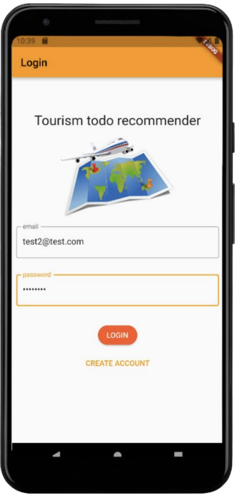
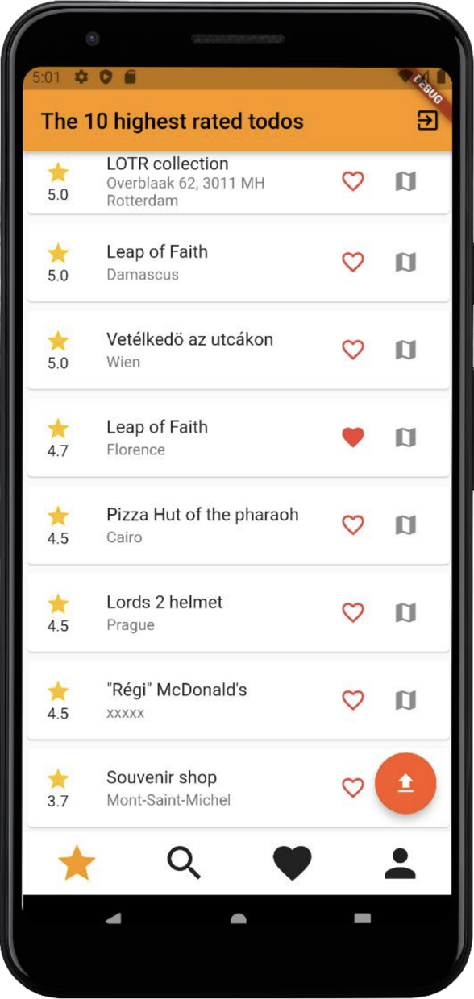
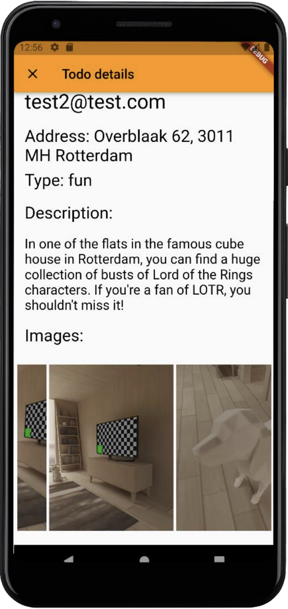
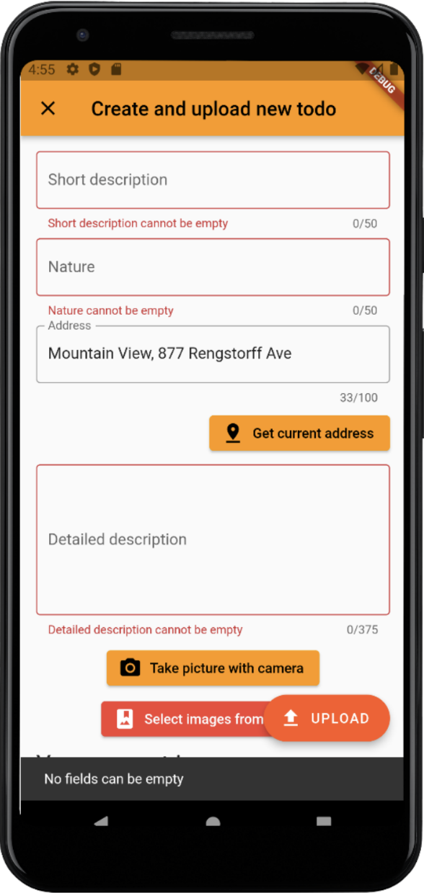

# tourism_todo_recommender

#### My BSc thesis project and MSc project laboratory project.
A mobile application for tourists. 
Logged-in users can create trip programs that other users can search, browse, save as favorites, rate and comment on. 
Frontend is made in Flutter and Firebase is used for authentication, database (Firestore), photo storage (Cloud Storage) and notification sending (Cloud Messaging). 
 
&emsp;&emsp;&emsp;&emsp; 
 
